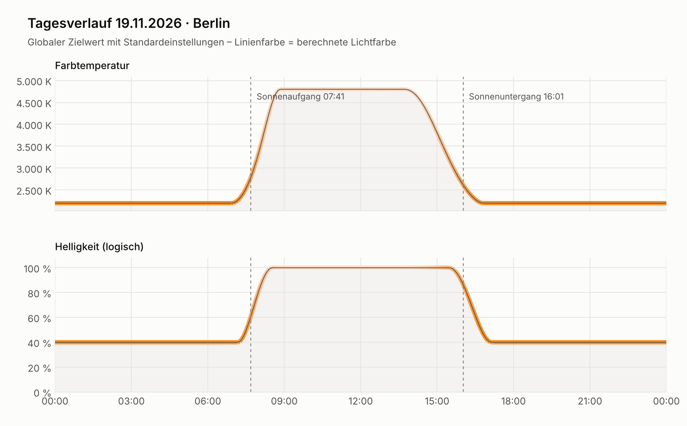

# Daylight Engine

Tageslicht-folgende Lichtsteuerung für Home Assistant – Nachfolger-Idee zu Adaptive Lighting
mit globalem Sleep-Modus, Kalibrierprofilen pro Lampe und gemischten RGB/CCT-Dimmkurven.

**Status: Phase 1 – Rechen-Engine.** Noch keine HA-Entitäten; die folgen in Phase 2.

## Aufbau

```
custom_components/daylight_engine/
  engine/              # reines Python, keine HA-Abhängigkeit
    sun.py             # Sonnenstand (NOAA), Morgen/Abend-Erkennung
    target.py          # globaler Zielwert: Helligkeit % + Kelvin aus Sonnenhöhe, Sleep-Override
    profile.py         # Lampenprofile: logische Helligkeit -> Gerätebefehl (CCT/RGB/On-Off)
    color.py           # Kelvin -> RGB, Kanal-Gains
    detect.py          # Fähigkeiten aus HA-Attributen + Standardprofil
    lamp.py            # Zielwert + Modus + Profil -> Befehl (inkl. Sleep-Verhalten pro Lampe)
tests/                 # pytest, inkl. Abgleich des Sonnenstands mit astral
scripts/simulate_day.py
```

## Konzepte

**Zielwert** – geräteunabhängig: *logische* Helligkeit (0–100 %, so wie man sie wahrnimmt) und Kelvin.
Beide folgen der Sonnenhöhe mit getrennten Rampen für Morgen und Abend (`Ramp(low, high, shape)`).
Kelvin wird in Mired interpoliert, damit der Verlauf gleichmäßig wirkt.

**Lampenprofil** – übersetzt logische Helligkeit in Gerätewerte über aufeinanderfolgende Segmente,
die zusammen (0, 100] abdecken:

- `CctSegment`: Stützpunkte logisch → Geräte-Helligkeit; Kelvin wird auf den Lampenbereich begrenzt
  (ohne Kelvin-Bereich = reiner Dimmer).
- `RgbSegment`: zusätzlich Kanal-Gains pro Stützpunkt, um nicht-lineare RGB-Kanäle zu korrigieren;
  Kelvin wird per RGB nachgebildet und auf `min_kelvin`/`max_kelvin` begrenzt.
- `OnOffProfile`: Schwellwert mit Hysterese.

An Segmentgrenzen verhindert eine Hysterese ständiges Umschalten zwischen RGB und CCT.
Profile lassen sich mit `profile_to_dict` / `profile_from_dict` als JSON speichern.

**Sleep pro Lampe** – `follow` (globaler Sleep-Zielwert), `minimum` (erster Kalibrierpunkt),
`off`, `unchanged`.

## Entwickeln

```bash
pip install -e ".[test]"
pytest
python scripts/simulate_day.py --lat 52.52 --lon 13.405 --step 30
python scripts/simulate_day.py --profile mein_profil.json      # mit Gerätebefehlen
```

## Vorschau der Engine




Neu erzeugen: `python scripts/render_docs.py` (benötigt matplotlib).
