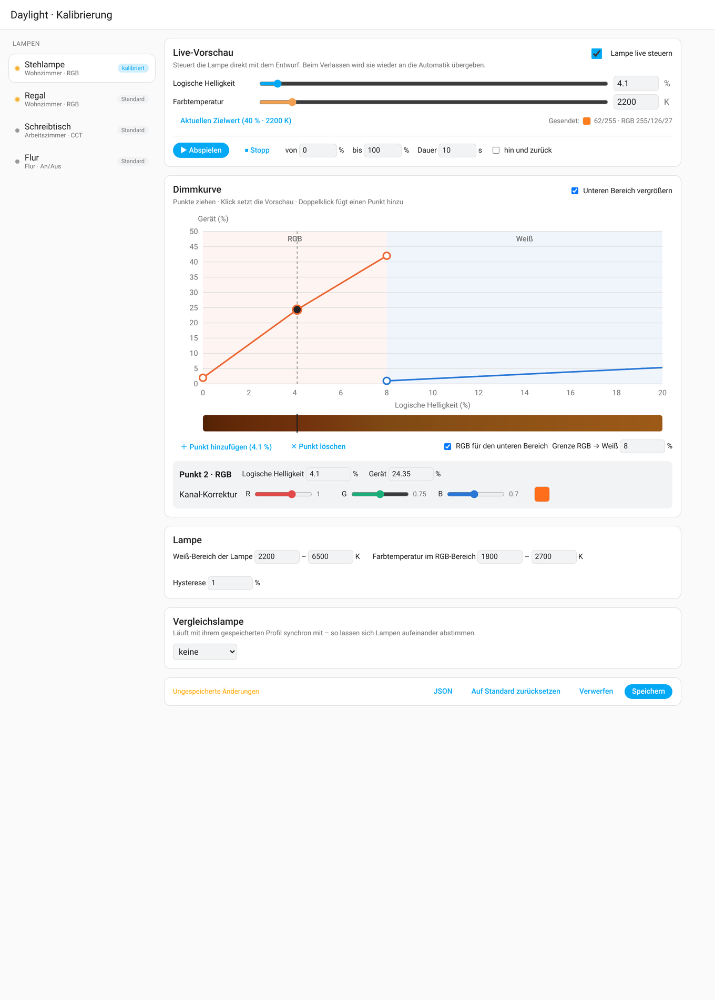
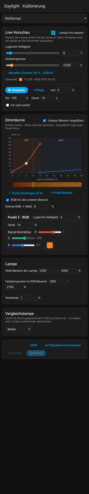

# Daylight Engine

Tageslicht-folgende Lichtsteuerung für Home Assistant – Nachfolger-Idee zu Adaptive Lighting
mit globalem Sleep-Modus, Kalibrierprofilen pro Lampe und gemischten RGB/CCT-Dimmkurven.

**Status: Phase 4 – Integration mit Kalibrier-Panel und Proxy-Lichtern.**

## Installation

HACS → *Benutzerdefinierte Repositories* → dieses Repo als *Integration* hinzufügen, oder den Ordner
`custom_components/daylight_engine` nach `config/custom_components/` kopieren. Danach Home Assistant neu starten
und unter *Einstellungen → Geräte & Dienste* „Daylight Engine“ hinzufügen.

## Einrichtung

- **Lampen:** im Integrationseintrag über *Lampe hinzufügen*. Mehrere Lampen mit gleichen Einstellungen dürfen
  in einen Eintrag. Pro Eintrag: Verhalten im Sleep-Modus, unter *Erweitert* Übergänge, Erkennung manueller Änderungen
  und *Proxy-Licht anlegen*.
- **Tageslichtkurve:** über *Konfigurieren*, aufgeteilt in Farbtemperatur, Helligkeit, Sleep-Modus,
  Aktualisierung und manuelle Änderungen (alle außer Farbtemperatur standardmäßig eingeklappt).
- **Lampentyp:** wird automatisch aus den Home-Assistant-Attributen erkannt (Farbmodi, Kelvin-Bereich, Übergänge) –
  egal ob Zigbee2MQTT, WLED, ESPHome oder anderes.

## Entitäten

| Entität | Zweck |
|---|---|
| `switch.…_automatik` | Automatik für alle Lampen an/aus. Attribute: verwaltete Lampen, Lampen unter manueller Steuerung |
| `switch.…_sleep_modus` | **Ein** Sleep-Schalter für alle Lampen |
| `switch.…_volle_helligkeit` | Alle Lampen hell und neutral (z. B. zum Suchen); exklusiv zum Sleep-Modus, endet optional automatisch |
| `sensor.…_ziel_helligkeit` / `…_ziel_farbtemperatur` | Aktueller globaler Zielwert |
| `sensor.…_sonnenhohe` | Diagnose, standardmäßig deaktiviert |

Dienste: `daylight_engine.apply` (Zielwert sofort senden) und `daylight_engine.reset_manual`.

## Proxy-Lichter

Mit *Erweitert → Proxy-Licht anlegen* bekommt jede Lampe des Eintrags ein zusätzliches Licht „<Name> Daylight“
(z. B. `light.stehlampe_daylight`). Es wird in Dashboards, Automationen und Sprachassistenten statt der
Originallampe verwendet:

- **Einschalten ohne Aufblitzen:** Der Proxy sendet sofort die passenden Werte in einem einzigen Befehl.
- **Kalibrierter Regler:** 5 % am Proxy sind 5 % *logisch* – inklusive RGB-Bereich und Kanal-Korrektur. „Alle auf
  20 %“ sieht dadurch überall gleich aus. RGB-only-Lampen (z. B. WLED) bekommen über ihr Profil einen
  Farbtemperatur-Modus.
- **Teilweise manuell:** Nur Helligkeit gesetzt → die Farbtemperatur folgt weiter dem Tageslicht (und umgekehrt).
  Farbe gewählt → die Lampe pausiert, bis sie aus- und wieder eingeschaltet wird (oder eine Farbtemperatur
  gewählt wird). Ausschalten, `reset_manual`, Sleep-Modus und „Volle Helligkeit“ heben das auf.
- Wird die Originallampe direkt geändert, zeigt der Proxy die passende logische Helligkeit (zurückgerechnet).

Die Originallampe bleibt unverändert nutzbar; dort greift wie bisher die Korrektur nach dem Einschalten.

## Kalibrierung

In der Seitenleiste erscheint **Daylight** (nur für Admins). Pro Lampe:

- **Live-Vorschau:** Schieberegler für logische Helligkeit und Farbtemperatur steuern die echte Lampe direkt mit
  dem ungespeicherten Entwurf. Solange die Vorschau läuft, hält sich die Automatik bei dieser Lampe raus; beim
  Verlassen des Panels (oder wenn der Browser geschlossen wird) bekommt sie die Lampe zurück – war sie vorher aus,
  geht sie wieder aus.
- **Abspielen:** fährt einen Bereich (z. B. 0–20 %) in einstellbarer Zeit ab, optional hin und zurück.
- **Dimmkurve:** Punkte ziehen, Doppelklick fügt Punkte hinzu, „Unteren Bereich vergrößern“ zoomt auf 0–20 %.
  Beim Ziehen springt die Vorschau auf genau diesen Punkt.
- **RGB für den unteren Bereich:** schaltet ein RGB-Segment unter die Weißkurve (Grenze frei wählbar). Pro
  RGB-Punkt gibt es eine **Kanal-Korrektur** (R/G/B), falls die Lampe beim Dimmen farblich kippt.
- **Vergleichslampe:** läuft synchron mit ihrem gespeicherten Profil mit, um Lampen aufeinander abzustimmen.
- **JSON:** Profil exportieren/importieren.
- **Befehle an die Lampe:** 2, 4 oder 10 pro Sekunde. Die Vorschau bündelt pro Lampe (immer der neueste Wert),
  überspringt identische Werte und sendet nur, was sich geändert hat – wichtig für Zigbee.



## Verhalten

- Aktualisiert nur **eingeschaltete** Lampen und schaltet nie eine Lampe selbst ein.
- Wird eine Lampe außerhalb der Integration eingeschaltet (Dashboard, Wandschalter, App), korrigiert sie sie sofort.
  Ein kurzes Aufblitzen ist ohne Proxy-Lichter (Phase 4) nicht vermeidbar.
- Kleine Zieländerungen unterhalb der Mindeständerung werden nicht gesendet; gleiche Befehle werden für mehrere
  Lampen gebündelt.
- **Manuelle Änderungen:** Ändert jemand Helligkeit/Farbe einer eingeschalteten Lampe, pausiert sie bis zum
  nächsten Aus/An (oder Timeout). Eigene Befehle werden über den HA-Kontext erkannt; späte Zwischenmeldungen
  während eines Übergangs und Meldungen, die dem gesendeten Wert entsprechen, zählen nicht als manuell.
- **Sleep pro Lampe:** folgen / minimal / aus / unverändert. Wird eine „aus“-Lampe im Sleep-Modus bewusst
  eingeschaltet, wird sie auf Minimum gedimmt statt wieder ausgeschaltet.
- **An/Aus-Lampen** werden nur vom Sleep-Modus („aus“) geschaltet, sonst nicht angefasst.
- Kalibrierprofile liegen in `.storage/daylight_engine.profiles`; ohne Profil gilt ein lineares Standardprofil.

## Aufbau

```
custom_components/daylight_engine/
  engine/              # reines Python, keine HA-Abhängigkeit
    sun.py             # Sonnenstand (NOAA), Morgen/Abend-Erkennung
    target.py          # globaler Zielwert: Helligkeit % + Kelvin aus Sonnenhöhe, Sleep-Override
    profile.py         # Lampenprofile: logische Helligkeit -> Gerätebefehl (CCT/RGB/On-Off)
    color.py           # Kelvin -> RGB, Kanal-Gains
    detect.py          # Fähigkeiten aus HA-Attributen + Standardprofil
    lamp.py            # Zielwert + Modus + Profil -> Befehl (inkl. Sleep-Verhalten pro Lampe)
tests/                 # pytest, inkl. Abgleich des Sonnenstands mit astral
scripts/simulate_day.py
```

## Konzepte

**Zielwert** – geräteunabhängig: *logische* Helligkeit (0–100 %, so wie man sie wahrnimmt) und Kelvin.
Beide folgen der Sonnenhöhe mit getrennten Rampen für Morgen und Abend (`Ramp(low, high, shape)`).
Kelvin wird in Mired interpoliert, damit der Verlauf gleichmäßig wirkt.

**Lampenprofil** – übersetzt logische Helligkeit in Gerätewerte über aufeinanderfolgende Segmente,
die zusammen (0, 100] abdecken:

- `CctSegment`: Stützpunkte logisch → Geräte-Helligkeit; Kelvin wird auf den Lampenbereich begrenzt
  (ohne Kelvin-Bereich = reiner Dimmer).
- `RgbSegment`: zusätzlich Kanal-Gains pro Stützpunkt, um nicht-lineare RGB-Kanäle zu korrigieren;
  Kelvin wird per RGB nachgebildet und auf `min_kelvin`/`max_kelvin` begrenzt.
- `OnOffProfile`: Schwellwert mit Hysterese.

An Segmentgrenzen verhindert eine Hysterese ständiges Umschalten zwischen RGB und CCT.
Profile lassen sich mit `profile_to_dict` / `profile_from_dict` als JSON speichern.

**Sleep pro Lampe** – `follow` (globaler Sleep-Zielwert), `minimum` (erster Kalibrierpunkt),
`off`, `unchanged`.

## Entwickeln

```bash
pip install -e ".[test]"   # bringt Home Assistant + Test-Harness + HA-Frontend mit
pytest

cd frontend && npm install
npm run build              # baut custom_components/daylight_engine/frontend/daylight-panel.js
npm test                   # JS-Rechenlogik gegen Python-Fixtures (test/make_fixtures.py)
node dev/browser-test.mjs  # Panel-Test in headless Chrome gegen simuliertes HA
python -m http.server -d .. 8765   # dann http://localhost:8765/frontend/dev/ (Panel ohne HA)
python scripts/simulate_day.py --lat 52.52 --lon 13.405 --step 30
python scripts/simulate_day.py --profile mein_profil.json      # mit Gerätebefehlen
```

Die Skripte und `engine/` kommen ohne Home Assistant aus.

## Vorschau der Engine




Neu erzeugen: `python scripts/render_docs.py` (benötigt matplotlib).
